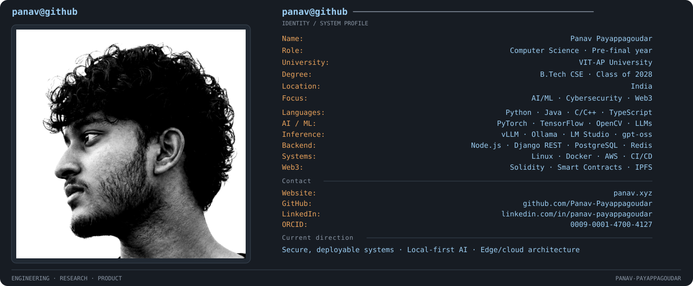

<picture>
  <source media="(prefers-color-scheme: dark)" srcset="profile-dark.svg">
  <source media="(prefers-color-scheme: light)" srcset="profile-light.svg">
  
</picture>

  <a href="https://panav.xyz">Website</a> ·
  <a href="https://www.linkedin.com/in/panav-payappagoudar/">LinkedIn</a> ·
  <a href="https://orcid.org/0009-0001-4700-4127">ORCID</a> ·
  <a href="mailto:panav.24bce707@vitapstudent.ac.in">Email</a>

---

## `01 / PROFILE`

I build secure, scalable systems at the intersection of **AI/ML, cybersecurity, and Web3**.

I am a Computer Science pre-final-year undergraduate at VIT-AP University (B.Tech ’28), focused on product-driven engineering: taking ideas from architecture to end-to-end prototypes that combine LLMs, decentralized systems, and robust backends.

My work spans applied machine learning, computer vision, LLM inference, privacy-aware systems, distributed software, and full-stack development. I value practical engineering: measurable constraints, reproducible demos, clear documentation, and deployable implementations.

## `02 / SELECTED RECOGNITION`

| Recognition | Result |
|---|---|
| Hackathon record | **2× Winner · 11× Finalist · 2× Runner-up** |
| Amazon ML Summer School ’26 | Selected participant |
| Microsoft Triwizardathon | **Top 2% — 23 / 1,290 teams** |
| IIT Bombay Techfest | Double finalist — Aarohan & AWS ImpactX |
| SimVerse ’25 | Hackathon winner |
| Matrix Hackathon | Top 10 finish |
| Radiothon ’26 | Top 5 finalist |
| GirlScript Summer of Code | Selected contributor — 2025 & 2026 |
| Six Sigma | White Belt certified |

**Selected engineering work**

- **SecureX — Microsoft Triwizardathon:** Led development of a decentralized document system combining IPFS, Ethereum smart contracts, client-side encryption, and LLM-based question answering.
- **Gravity Sandbox — SimVerse ’25:** Built a real-time collaborative N-body simulation with numerical integration and browser-based rendering.
- **ClaimAgent — Radiothon ’26:** Developed an AI-assisted clinical prior-authorization workflow combining document understanding, retrieval, deterministic checks, and browser automation.

## `03 / RESEARCH & EXPERIENCE`

| Role | Organization | Period |
|---|---|---|
| Open Source Contributor | GirlScript Summer of Code ’26 | May 2026 – Present |
| Technical Blogger | Medium & Hashnode | Oct 2025 – Present |
| Deep Learning & Computer Vision Associate | Machine Learning Club, VIT-AP | Aug 2025 – Jun 2026 |
| Undergraduate Robotics Researcher | VIT-AP University | Jul 2025 – Dec 2025 |
| Technical Team Associate | Machine Learning Club, VIT-AP | Nov 2024 – Aug 2025 |
| AI & Cloud Intern | IBM SkillsBuild | Sep 2025 – Oct 2025 |
| Conversational Data Intern | Vodafone Idea Foundation | Sep 2025 – Oct 2025 |

**Research directions**

- **LLM systems:** Inference optimization, model serving, and efficient local execution.
- **Privacy-aware computing:** Edge/cloud system design and local-first processing.
- **Computer vision:** Sketch-to-face matching for forensic applications.
- **Geospatial ML:** LiDAR, satellite imagery, and U-Net-based segmentation.
- **Robotics:** Human-following systems using IR and ultrasonic sensing.

## `04 / SELECTED PROJECTS`

A selection of engineering projects across AI, systems, security, geospatial computing, and robotics.

| Project | Overview | Technologies |
|---|---|---|
| [SecureX](https://github.com/Panav-Payappagoudar/Secure-X) | Zero-trust document platform with client-side encryption, decentralized storage, and on-chain access governance. [Live demo](https://final-secure-x-ix3r.vercel.app/) | Solidity · Ethereum · IPFS · Web Crypto · React |
| [Gravity Sandbox](https://github.com/Panav-Payappagoudar/SimVerse25) | Real-time collaborative N-body astrophysics simulation using numerical integration and WebGL. | Three.js · WebGL · Socket.io · Node.js |
| [ClaimAgent](https://github.com/Panav-Payappagoudar/ClaimAgent) | Clinical prior-authorization automation combining multimodal document extraction, RAG, deterministic checks, and browser automation. | Gemini · RAG · Playwright · Node.js |
| [Geospatial Change Detection](https://github.com/Panav-Payappagoudar/ISRO-Hackathon) | Multi-temporal Sentinel-2 analysis, cloud masking, spectral indices, and spatial change detection. | Python · FastAPI · PostGIS · Rasterio · GDAL |
| [OmitFS](https://github.com/Panav-Payappagoudar/OmitFS) | Zero-dependency semantic filesystem prototype exploring intent-based file addressing. | Rust · POSIX · Systems Programming |
| [VectorGit](https://github.com/Panav-Payappagoudar/VectorGit) | Semantic search over Git metadata, commit diffs, and repository history. | Rust · Vector Embeddings · Git Internals |
| [Sketch-to-Face Forensics](https://github.com/Panav-Payappagoudar/Sketch-to-face-forensics) | Computer-vision research exploring forensic sketch-to-face matching and image translation. | TensorFlow · OpenCV · CNNs · GANs |
| [GridShield](https://github.com/Panav-Payappagoudar/GridShield) | Network telemetry and anomaly detection prototype for distributed systems. | Python · Networking · Cryptography |
| [Clarity AI](https://github.com/Panav-Payappagoudar/Clarity-AI) | Air-quality prediction pipeline for PM2.5 / PM10 using engineered environmental features. | Python · scikit-learn · Flask · React |
| [HealthGuard AI](https://github.com/Panav-Payappagoudar/HealthGuard_AI) | Cross-platform health companion with AI assistance, offline-aware workflows, and hospital discovery. | Flutter · Dart · OpenStreetMap |
| [Distributed Booking System](https://github.com/Panav-Payappagoudar/Travel-Booking) | Reservation backend with asynchronous task processing and relational transactions. | Django · PostgreSQL · Redis · Celery |
| Human-Following Robot | Embedded robotics prototype using sensor fusion and differential-drive control. | Arduino · Embedded C++ · IR · Ultrasonic |

## `05 / TECHNICAL PROFILE`

**AI / ML & Data**  
Deep Learning · Computer Vision · Neural Networks · LLMs · RAG · Model Fine-tuning · NumPy · OpenCV · scikit-learn · TensorFlow · PyTorch

**LLM Runtime & Inference**  
gpt-oss · vLLM · Ollama · LM Studio · Local inference · Model serving · Cost and latency optimization

**Cybersecurity & Web3**  
Solidity · Smart Contracts · IPFS · Cryptography · Secure System Design · Threat Modeling · DNS-over-TLS

**Full-stack & Backend**  
React · TypeScript · Node.js · Django REST Framework · Flutter · PostgreSQL · MongoDB · Redis

**Infrastructure & Engineering**  
AWS · Docker · CI/CD · Linux · Fedora · Server Management · Git · Reproducible Deployments

**Development Environment**  
VS Code · Android Studio · Xcode

## `06 / WHAT I BUILD`

- **Secure, deployable prototypes** with attention to architecture, reliability, and maintainability.
- **LLM-powered systems** designed around cost, latency, local inference, and cloud fallback.
- **Cross-domain applications** combining AI, Web3, backend engineering, and system design.
- **Reproducible engineering work** supported by source repositories, documentation, and deployment scripts.

## `07 / EDUCATION`

**VIT-AP University**  
B.Tech — Computer Science and Engineering  
2024–2028 · Pre-final year

---

  <a href="https://panav.xyz">panav.xyz</a> ·
  <a href="https://github.com/Panav-Payappagoudar">GitHub</a> ·
  <a href="https://www.linkedin.com/in/panav-payappagoudar/">LinkedIn</a> ·
  <a href="https://orcid.org/0009-0001-4700-4127">ORCID</a>

